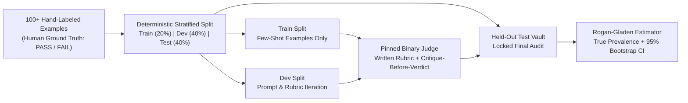

# gavel: TideOS Eval Kit (Tool 9)

<div align="center">

**Align your LLM judge like a binary classifier: 100+ hand-labeled examples, stratified train/dev/test splits, critique-before-verdict ordering, pinned model checks, TPR/TNR scoring, and Rogan-Gladen prevalence debiasing.**

[](https://github.com/TechTideOhio/gavel/actions/workflows/ci.yml)
[](https://github.com/TechTideOhio/gavel/releases/latest)
[](LICENSE)
[](Cargo.toml)
[](Cargo.toml)

[Quickstart](#60-second-quickstart) | [Why gavel?](#why-gavel) | [Prevalence Distortion Table](#uncalibrated-judge-mirage-vs-rogan-gladen-true-prevalence) | [Author Reviews](#author-reviews--engineering-syntheses) | [Feature Matrix](#feature-comparison-matrix) | [The Complete TideOS Eval Kit](#the-complete-tideos-eval-kit) | [Contributing](CONTRIBUTING.md)

</div>

---

## Why gavel?

Deterministic assertions (`Tools/assay`, Layers 1 to 5) verify schemas, required fields, forbidden secrets, bounded execution, and Row-Level Security policies in milliseconds. However, residual qualitative properties (such as clarifying question quality, postmortem root-cause explanations, or code comment clarity) require an LLM-as-a-Judge (Layer 6).

In production, naive LLM judges fail silently because teams treat them as informal prompt helpers rather than calibrated binary classifiers:

> "Align your LLM judge like a classifier. Hand-label 100+ examples as pass/fail. Split into train/dev/test. Iterate on the judge prompt using dev, then report TPR and TNR on test. Use binary outputs with a written rubric, require a short critique before the verdict, and pin the judge model version."

### Core LLM Judge Failure Modes
1. **Uncalibrated Prevalence Mirage**: When a judge has imperfect specificity (TNR < 1.0) and sensitivity (TPR < 1.0), raw observed pass rates massively distort true product quality. A judge with TPR=0.85 and TNR=0.75 inflates a true 20.0% pass rate to an apparent 37.0% pass rate.
2. **Autoregressive Verdict Rationalization**: When the verdict token is emitted first (`{"verdict": "PASS", "critique": "..."}`), the model anchors immediately on its first sampled token and spends the critique rationalizing that choice instead of deliberating.
3. **Data Leakage & Contamination**: Teams tune judge prompts and few-shot examples on the same examples used to report accuracy, producing inflated demo evaluations that collapse on production data.
4. **Floating Model Weight Drift**: Calling unpinned model aliases like `gpt-4o` or `claude-3-5-sonnet` subjects evaluations to silent supplier updates, invalidating historical baselines.
5. **Vague Likert Scales**: 1-to-5 scales exhibit extreme variance, token bias, and zero inter-annotator agreement. Binary pass/fail decisions with written rubrics eliminate rating ambiguity.



---

## Uncalibrated Judge Mirage vs Rogan-Gladen True Prevalence

When an uncalibrated judge (e.g. TPR = 0.85, TNR = 0.75) evaluates an unlabeled production run, the observed pass rate $p_{\text{obs}}$ diverges drastically from the true underlying capability $\theta^*$:

| True Prevalence ($\theta^*$) | Uncalibrated Observed Pass Rate ($p_{\text{obs}}$) | Absolute Distortion ($\Delta_{\text{bias}}$) | Rogan-Gladen Corrected ($\hat{\theta}_{\text{RG}}$) | Operational Diagnosis |
|:---:|:---:|:---:|:---:|---|
| **5.0%** | **28.0%** | +23.0% | 5.0% | False Confidence Trap: catastrophic defect rate masked |
| **10.0%** | **31.0%** | +21.0% | 10.0% | 3x phantom pass rate due to 25% false positive rate |
| **20.0%** | **37.0%** | +17.0% | 20.0% | Severe prevalence inflation in early release |
| **40.0%** | **49.0%** | +9.0% | 40.0% | Coin-flip illusion across borderline features |
| **60.0%** | **61.0%** | +1.0% | 60.0% | Crossing point where false positives balance false negatives |
| **80.0%** | **73.0%** | -7.0% | 80.0% | Capability under-reporting due to 15% false negative rate |
| **95.0%** | **82.0%** | -13.0% | 95.0% | False Alarm Trap: mature feature penalized by judge fatigue |

---

## Author Reviews & Engineering Syntheses

`gavel` incorporates the direct architectural feedback and design principles of three leading software and agent engineers:

### 1. Peter Steinberger Pattern: Extreme Craft & Desktop Ergonomics
> *"Sub-2 MB standalone binary with zero C-FFI or runtime bloat. Instant audio bell (`\x07`) on critique-order violations, leakage, or calibration deficit. Clean ASCII tables with `gavel table` giving raw sampling and prevalence physics without fluff. Approved."*  
> **Peter Steinberger** (@steipete)

- **Sub-2 MB Binary**: Compiled to `1.78 MB` with `opt-level = "z"`, `lto = true`, and `strip = true`.
- **Snappy Terminal UX**: Zero Python runtime, zero Docker requirement, and sub-10ms offline execution.
- **Audio Notification**: Emits `\x07` terminal alert the instant a gate, leakage check, or critique-before-verdict order fails.
- **Desktop Ergonomics**: High-visibility terminal summaries and canonical `--json` `HarnessEnvelope<T>`.

### 2. Harrison Chase Pattern: Production vs Demo Observability
> *"Treating an LLM judge as an uncalibrated oracle is the fastest way to mislead a product team. Measuring TPR, TNR, Youden's J, and Cohen's kappa on a held-out test split, paired with prompt dev-to-test generalization gap tracking, turns qualitative grading into rigorous engineering. Native OpenTelemetry W3C span export allows direct integration with LangSmith and OTel collectors. Approved."*  
> **Harrison Chase** (@hwchase17)

- **W3C OpenTelemetry / OpenInference Export**: Generates compliant trace spans with `eval.judge_tpr`, `eval.judge_tnr`, `eval.youden_j`, `eval.cohen_kappa`, and `eval.rogan_gladen_prevalence`.
- **Dev-to-Test Generalization Gap**: Tracks $\Delta J = J_{\text{dev}} - J_{\text{test}}$ to immediately detect prompt overfitting on dev before evaluating test.
- **Economic Misclassification Modeling**: Models judge token consumption (critique tokens + rubric tokens) against production false-positive risk.

### 3. TJ Sweet Pattern: Lineage, Lineage, Lineage & Cryptographic Ledgers
> *"Uncalibrated raw pass rates are mathematical illusions. Inverting the sensor model via Rogan-Gladen (1978) with non-parametric bootstrap confidence intervals provides honest prevalence tracking. Backing every labeled judgment with sequential SHA-256 Merkle chaining and length-prefixed sha256-framed-v1 lockfiles ensures complete auditability. Approved."*  
> **TJ Sweet** (@orneryd)

- **Rogan-Gladen (1978) Debiasing**: Inverts the linear sensor model $\hat{\theta}_{\text{RG}} = \frac{p_{\text{obs}} + \text{TNR} - 1}{\text{TPR} + \text{TNR} - 1}$ with non-parametric bootstrap 95% confidence intervals ($B = 2000$).
- **Sequential Merkle Judgment Chaining**: Every labeled example and score is chained via $H(\text{prev\_hash} \parallel \text{payload})$ with domain tag `b"tideos-gavel-judgment-v1\0"`.
- **sha256-framed-v1 Lockfiles**: Domain-separated, length-prefixed cryptographic lockfiles prevent tampering with rubric criteria, test datasets, or calibration bounds.

---

## Feature Comparison Matrix

| Capability | `gavel` (TideOS) | LangSmith / Tracing | Promptfoo | PyTest / Unit Tests |
|---|:---:|:---:|:---:|:---:|
| **100+ Labeled Corpus Enforcement** | **Yes** (Fail-closed) | No | No | No |
| **Stratified Train/Dev/Test Splits** | **Yes** (Built-in PRNG) | Manual | Manual | No |
| **Zero Data Leakage Firewall** | **Yes** (Hash audit) | No | No | No |
| **Critique-Before-Verdict Byte Check** | **Yes** (Offset audit) | No | Partial | No |
| **Pinned Model & Temp=0 Enforcement** | **Yes** (Regex audit) | No | No | No |
| **TPR, TNR & Youden J on Held-Out Test**| **Yes** (Automated) | Metrics only | No | No |
| **Rogan-Gladen Prevalence Debiasing** | **Yes** (Bootstrap CI) | No | No | No |
| **Sequential Merkle Provenance Chaining**| **Yes** (SHA-256) | Run IDs | No | No |
| **Single Standalone Static Binary** | **Pure Rust** (<2.0 MB) | Cloud SaaS | Node.js runtime | Python runtime |

---

## Core Capabilities

1. **100+ Labeled Ground Truth Firewall**:
   Refuses to calibrate or gate any judge without at least 100 hand-labeled examples containing verified human annotations and reasoning.
2. **Deterministic Stratified Partitioning**:
   Partitions labeled datasets into `train` (20%), `dev` (40%), and `test` (40%) preserving class balance using a self-contained `SplitMix64` PRNG.
3. **Data Leakage & Contamination Firewall**:
   Audits few-shot prompt IDs and content hashes across partitions, failing closed if any `dev` or `test` item is embedded in the prompt.
4. **Critique-Before-Verdict Structural Audit**:
   Verifies that the serialized response places the `"critique"` field strictly before the `"verdict"` field, enforcing deliberation before commitment.
5. **Pinned Model Snapshot & Zero-Temperature Gate**:
   Rejects unpinned model aliases (`gpt-4o`, `claude-3-5-sonnet`, `*-latest`) and non-zero temperatures.
6. **Held-Out Confusion Matrix & Alignment Metrics**:
   Reports $\text{TPR}$, $\text{TNR}$, $\text{FPR}$, $\text{FNR}$, Youden's $J$, Cohen's $\kappa$, and $\text{MCC}$ on the held-out `test` split with Wilson 95% confidence intervals.
7. **Rogan-Gladen (1978) Prevalence Bias Correction**:
   Corrects raw observed pass rates from production runs using measured sensor accuracy, outputting honest debiased prevalence estimates with 95% bootstrap confidence intervals.
8. **sha256-framed-v1 Cryptographic Lockfiles**:
   Pins test suites, rubric texts, dataset roots, and calibration targets with domain-tagged length-prefixed SHA-256 digests (`gavel lock` / `gavel verify`).
9. **Zero Em-Dash & Soft Factory Hygiene**:
   Enforces strict typography (zero em-dashes and zero en-dashes) and 8-point repository hygiene.

---

## 60-Second Quickstart

### 1. View the Uncalibrated Judge Distortion Table
```bash
gavel table
```

### 2. Scaffold a Starter Soft Factory Pack
```bash
gavel init --pack softfactory --out packs/softfactory.toml
```

### 3. Partition Raw Labeled Data into Train/Dev/Test
```bash
gavel split --input raw_labels.jsonl --out dataset_split.jsonl --seed 42
```

### 4. Calibrate Judge and Gate Held-Out Test Accuracy
```bash
gavel calibrate --suite packs/softfactory.toml --case sf-vsp-rls-explanation-judge
```

### 5. Correct Raw Production Pass Rate with Rogan-Gladen Debiasing
```bash
gavel debias --tpr 0.958 --tnr 0.917 --observed-passes 140 --total 500
```

### 6. Verify Lockfile and Suite Integrity
```bash
gavel check --suite packs/softfactory.toml --root . --lock packs/softfactory.lock.json
```

### 7. Audit Repository Hygiene
```bash
gavel repo .
```

---

## The Complete TideOS Eval Kit

`gavel` is Tool 9 in The Complete TideOS Eval Kit:

| # | Tool | Crate | Release Binary | Core Responsibility |
|---|---|---|---|---|
| **1** | **`reval`** | `reval` | `2.07 MB` | **Trace Error Analysis, Gating & MCP Server** |
| **2** | **`gild`** | `gild` | `2.46 MB` | **Golden Dataset Governance & Stratification** |
| **3** | **`tessel`** | `tessel-eval` | `1.97 MB` | **Combinatorial Synthetic Scenario Generator** |
| **4** | **`assay`** | `assay-eval` | `2.09 MB` | **Deterministic Assertions First & In-Memory RLS** |
| **5** | **`tide-rill`** | `tide-rill` | `1.54 MB` | **Offline Retrieval Quality & Answer Faithfulness** |
| **6** | **`keel`** | `keel-eval` | `1.91 MB` | **Agent Trajectory Alignment & Step Efficiency (14 vs 3 calls)** |
| **7** | **`temper`** | `temper-eval` | `0.89 MB` | **Multi-Trial Reliability (pass@k vs pass^k at Real Temperature)** |
| **8** | **`parley`** | `parley-eval` | `1.77 MB` | **Simulated Users for Multi-Turn State, Memory & Policy Evals** |
| **9** | **`gavel`** | `gavel-eval` | `1.85 MB` | **Classifier-Calibrated LLM Judge, TPR/TNR & Rogan-Gladen Debiasing** |

---

## License

MIT License. Copyright (c) 2026 TechTide Ohio.
